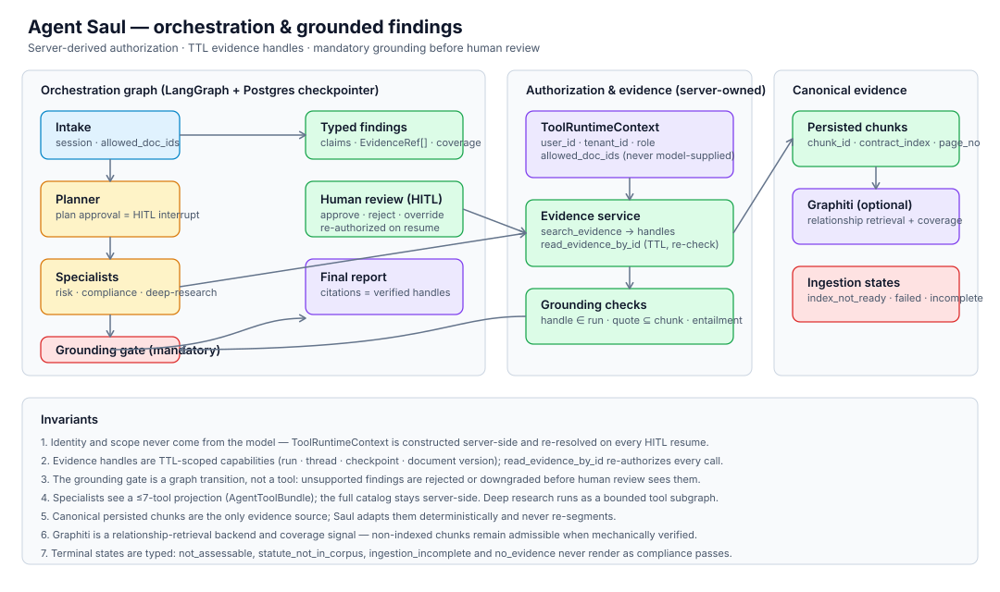
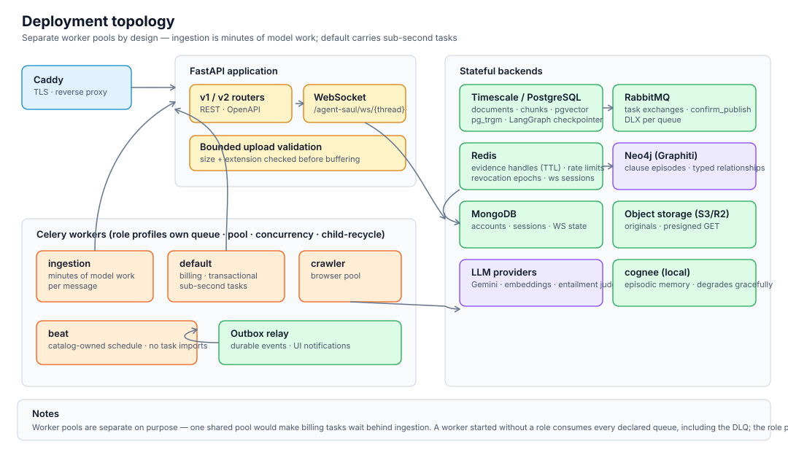
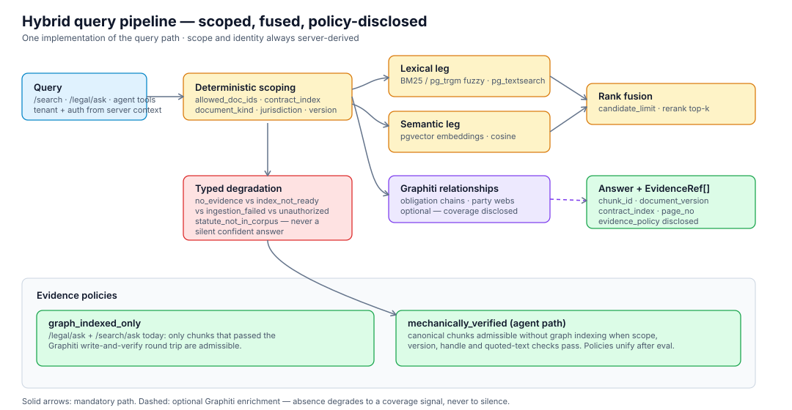
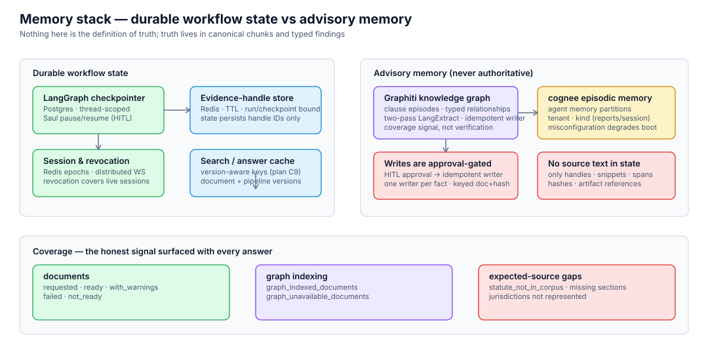
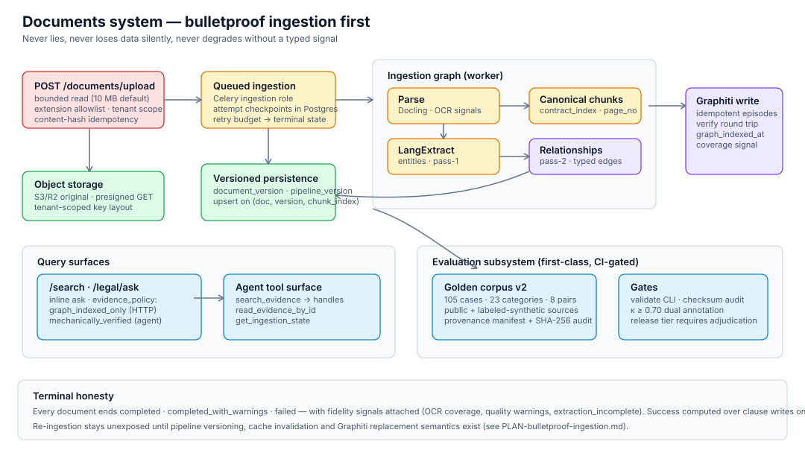

# Agent Saul

Graph-backed, human-verified legal intelligence for Indian contracts.

📚 **Documentation:** Mintlify site in [`docs-site/`](docs-site/README.md) — `cd docs-site` and run `npx mintlify dev` locally.

This project is built with FastAPI, LangChain, LangGraph, LangSmith, Gemini, TigerData-backed Postgres, Neo4j, and Graphiti. It is not a generic agent sandbox. It is a stateful legal reasoning system designed around resumability, memory discipline, human review, and deterministic execution.

## Moto of this project

AI Agents should never be replacing Humans. They should be your devoted digital companions, ever-ready to absorb the soul-crushing repetition and mindless grunt work that slowly poisons the very profession you once chased with youthful fire.

Neither should you use AI Agents to do the job for you completely end-to-end. Instead, you should be doing AI-assisted work that feels like a genuinely ergonomic work chair: removing avoidable strain, reducing dread-filled procrastination, cutting down existential second-guessing, and lowering the quiet terror of "what if I chose wrong?".

If your agents free time that would otherwise be wasted on repetitive cognitive drag, that time should go back to being more human, lifting invisible weight off your shoulders instead of turning your hair white early.

This is a graph-backed, human-verified legal intelligence platform for Indian contracts.

## I am building a stateful, resumable, memory-aware reasoning pipeline

A distributed, resumable, schema-driven cognitive workflow engine with controlled reasoning surfaces. It has three layers:

1. Memory shaping: filters, trimming, bounded context.
2. Runtime control: dynamic agents, routing, orchestration.
3. Execution durability: pause, resume, retry, replay.

The real architecture:

- LLM = stateless reasoning engine
- State = source of truth
- Memory = indexed projections of state

The deepest insight: if your system cannot deterministically replay a run, you do not control your agent.

Final mental model:

```text
Plan -> deterministic execution -> validated output -> persisted state
```

Not:

```text
LLM -> decide -> act -> hope it works
```

## Workflow choice and reasoning

The orchestration model is deliberate.

Main agent plans -> delegates to workers -> synthesizes.

That maps cleanly to the actual requirements:

- Deterministic workflows: explicit plan -> worker -> reflect loop
- Multi-step planning: main orchestrator generates plan steps
- Repeated tool calls: workers loop until the plan is complete
- Self-reflection: orchestrator reviews worker outputs
- Error recovery: orchestrator handles failures and replans
- Agent coordination: workers are specialized sub-agents
- Shared state: orchestrator owns `LegalAgentState`, workers read and write through controlled surfaces

## LangGraph performance rules

Do not initialize models or compile agents inside LangGraph nodes. That is the fast path to slow requests, memory churn, noisy traces, and production pain.

Bad pattern:

```python
def research_node(state):
    model = init_chat_model("gpt-4o")
    agent = create_agent(model, tools)
    return agent.invoke(state)
```

Why it hurts:

- Model initialization can spend 100-500ms fetching config and metadata.
- Agent construction can add another 50ms or more.
- Ten nodes across ten concurrent requests can become hundreds of avoidable model/agent constructions per second.
- LangSmith traces become harder to compare because the runtime shape keeps being rebuilt.
- Memory use grows with repeated object creation instead of stable reuse.

Correct pattern:

```python
research_agent = create_agent(
    init_chat_model("gpt-4o"),
    tools=[search_caselaw],
)


def research_node(state):
    return research_agent.invoke(state)
```

Compile models, tools, and agents once at startup. Then pass compiled callables into graph nodes. Node functions should execute workflow logic, not rebuild the runtime.

The intended node strategy:

- Precompile `create_agent(...)` outside the graph.
- Pass node callables into `graph.add_node(...)`.
- Use per-node or per-workflow checkpointers where isolation matters.
- Use explicit model lookup tables for dynamic model selection.
- Initialize heavy resources in FastAPI lifespan, then read them from `app.state`.

The expected result is lower latency, stable memory, reusable traces, and a graph that behaves like infrastructure instead of improvisation.

## Why this exists

This is not about shallow "time-saving".

Legal work has a strange cruelty to it: the most expensive human judgment often sits behind a wall of repetitive reading, clause sorting, calendar math, template comparison, and anxious second-guessing. The people who need clarity most are usually the least able to buy it continuously: founders signing vendor terms, families reading settlement papers, policyholders facing claim language, and small businesses trying not to discover a liability clause after the damage is done.

Agent Saul exists to reduce that information asymmetry. Not by pretending to be a lawyer, and not by turning legal judgment into autocomplete, but by making the repetitive surface area small enough that humans can spend their attention on the parts that actually require judgment.

The actual pain in India is different:

- Small startups often cannot access strong legal teams.
- Individuals are frequently unaware of their legal rights and get intimidated by fine print and legal notices.
- A lot of legal work is repetitive, high-volume, low-intelligence grunt work that should be automated.
- Most existing contract AI products were trained around US/UK assumptions, not Indian statutes, procedures, and enforcement realities.

High-volume work worth automating:

- Clause tagging
- Risk flagging such as one-sided indemnity or unlimited liability
- Deadline tracking
- Template comparison
- Stamp duty and jurisdiction sanity checks
- "Is this clause enforceable in India?"

Time is a symptom. Risk and uncertainty are the disease.

The same pattern shows up across domains:

- Insurance: detect claim-rejection loopholes and reduce policyholder vs insurer asymmetry.
- Healthcare: review hospital contracts, consent forms, vendor SLAs, and clinical establishment compliance.
- Family settlements and prenups: reason about Indian enforceability, asset disclosure, and future dispute risk.
- Business contracts: help MSMEs understand vendor lock-in, liability caps, payment traps, and jurisdiction exposure.
- Wills and land: flag title risk, ambiguous beneficiary clauses, and state-specific succession issues.

## What is inside

- Indian contract analysis with human verification before trusted persistence
- LangGraph-based orchestration for resumable, stateful legal workflows
- TigerData/Postgres-backed retrieval using `pgvector`, `pgvectorscale`, and `pg_textsearch`
- Neo4j + Graphiti for graph-backed memory, precedent chains, and relationship traversal
- Document ingestion and parsing with Docling
- Web research and crawling with Crawl4AI and Tavily-backed tools
- FastAPI APIs (v1 + v2) for ingestion, search, crawling, documents, billing,
  and Agent Saul workflows
- LangSmith tracing for execution visibility and debugging
- Redis, Celery, and durable checkpoints for retries, resumability, and background work

## Architecture











The architecture notes that drive this repo live in [`docs-site/`](docs-site/README.md)
(architecture section) and in the diagrams above. `docs/` holds working notes,
not user documentation.

## Stack

- API layer: FastAPI
- Orchestration: LangGraph
- LLM layer: LangChain + Google Gemini
- Observability: LangSmith
- Vector and text retrieval: Postgres on TigerData with `pgvector`, `pgvectorscale`, `pg_textsearch`
- Graph memory: Neo4j
- Graph extraction and retrieval: Graphiti
- Cache and idempotency: Redis
- Background execution: Celery
- Document processing: Docling, LangExtract
- Crawling and search: Crawl4AI, Tavily
- MCP integration: FastMCP

## Human-in-the-loop is mandatory

Why humans are required:

- Legal liability
- Continuous improvement
- Trust formation

What humans do:

- Approve or reject risks
- Correct clauses
- Annotate reasoning

What gets stored:

- Overrides
- Comments
- Reviewer role

This becomes training data and audit data, not just UI feedback.

## Why this workflow is correct

- No cycles before human review: avoids compounding hallucinations
- Risk and compliance are separated: legal correctness matters more than linguistic fluency
- Human gate before persistence: memory becomes trusted memory

In Indian legal work, judgment interpretation is not optional context. The system has to preserve judgment context, surface conflicting rulings, and distinguish what binds a District Court, a High Court, and the Supreme Court of India.

## Context window discipline

Agents do not only spend tokens on user prompts. The context window fills from several sources:

```text
system prompt             2K-5K tokens
bootstrap files           varies, often large
memory files              grows over time
skills and instructions   per selected skill
conversation history      primary recurring cost
tool output history       silent killer, can reach huge character counts
compaction summaries      usually 1K-3K tokens
```

The system should treat context as an operating budget, not a junk drawer.

Practical rules:

- Keep state canonical and memory as indexed projections of state.
- Summarize or truncate tool outputs before they become permanent conversation drag.
- Prefer retrieval of focused facts over loading entire documents.
- Keep prompts stable and small enough to audit.
- Preserve citations, IDs, and decision points rather than every intermediate paragraph.
- Design graph nodes so each node receives the minimum state it needs.

## Prerequisites

- Python `3.12+`
- `uv`
- `ruff`
- `ty`
- PostgreSQL or TigerData Postgres (**required** — the app answers 503 without it,
  and the schema needs the `vector`, `vectorscale`, `pg_trgm`, and `pg_textsearch`
  extensions, which revision `0001` installs itself)
- Neo4j (optional at boot — graph features stay disabled without it)
- Redis (optional at boot — caching/idempotency helpers degrade without it)
- MongoDB (optional at boot — document store stays disabled without it)
- RabbitMQ for Celery (`docker compose up -d rabbitmq` covers local use)
- Google Gemini API key
- LangSmith API key for tracing, if you want observability enabled

## Installation

### 1. Clone the repository

```bash
git clone https://github.com/Harmeet10000/AgentNexus-LangChain-FastAPI.git
cd AgentNexus-LangChain-FastAPI
```

### 2. Configure the environment

```bash
cp .env.example .env.development
```

Settings load from `.env.development` (see `src/app/config/settings.py`). At minimum
set `POSTGRES_URL`, `RABBITMQ_URL`, `GEMINI_API_KEY`, and the object-storage
credentials; everything else degrades: without Redis/MongoDB/Neo4j the app boots
with those features disabled, but **without PostgreSQL it refuses to start**
(lifespan answers 503).

### 3. Start local infrastructure

```bash
docker compose up -d rabbitmq timescale
```

This provides RabbitMQ and PostgreSQL. Revision `0001` installs the required
extensions itself (`vector`, `vectorscale`, `pg_trgm`, `pg_textsearch`), then:

```bash
uv run alembic upgrade head
```

Note: the migration chain assumes the provisioned lineage — a brand-new database
stops at revisions whose tables predate the chain (documented in
`src/alembic/versions/0012_*` and `0014_*`). If `upgrade head` fails past the
extensions, you are past what a fresh database can reach; use a provisioned
snapshot instead.

### 4. Install dependencies

```bash
uv venv
source .venv/bin/activate
uv sync
uv sync --extra dev
```

### 5. Run the app

```bash
uv run uvicorn app.main:app --reload --reload-dir src --host 0.0.0.0 --port 5000 --no-access-log
uv run python src/app/server.py
```

## Common commands

```bash
uv run pre-commit run --all-files
uv run alembic revision --autogenerate -m "Add user table"
uv run alembic upgrade head
uv run alembic downgrade -1
uv run alembic current
uv run alembic history --verbose
uv run ruff check --fix
uv run ruff format
uv run pytest -x
uv run worker --role default --loglevel=info
uv run worker --role ingestion --loglevel=info
uv run worker --role crawler --loglevel=info
uv run beat --loglevel=info
```

Those four commands are defined once in the `Makefile` — `make celery`, `make celery-ingestion`,
`make celery-crawler` and `make celery-beat` run exactly them, and `make celery-command` prints the
three worker commands. The role profile owns the queue, prefork pool, concurrency and child-recycle
limit; deployments should not add a second `-Q` or process-shape flag.

Two details worth knowing before changing them. The role interface emits exactly one queue selection;
a worker started without one consumes every queue the application declares, including the
dead-letter queue. And **the worker pools are separate on purpose**: ingestion is minutes of model
work per message, while the default queue carries sub-second billing and transactional-email tasks,
so a single shared pool makes those wait behind ingestion whenever every slot is busy.

## Project structure

```text
.
├── README.md
├── docs/                       # working notes; user docs live in docs-site/
│   └── diagrams/               # architecture SVGs rendered above
├── docs-site/                  # Mintlify site (docs.json); run `npx mintlify dev` inside it
├── tests/
│   ├── unit/
│   ├── integration/
│   ├── e2e/
│   ├── property/
│   └── performance/
├── src/
│   ├── app/
│   │   ├── api/                # v1 + v2 router composition, response envelope
│   │   ├── features/           # auth, users, profile, documents, ingestion,
│   │   │                       # crawler, agent_saul, billing, health, audit
│   │   ├── connections/        # postgres, redis, mongo, neo4j, celery, s3, mailer
│   │   ├── worker/             # role profiles, celery runtime, jobs, child lifecycle
│   │   ├── events/             # transactional outbox model, writer, relay
│   │   ├── lifecycle/          # startup/shutdown wiring (lifespan)
│   │   ├── shared/             # cross-feature helpers, jobs contracts, rag
│   │   ├── kernel/             # pure domain primitives, error vocabulary
│   │   ├── extraction/         # docling, langextract engines
│   │   ├── retrieval/          # ranking, chunk policy, context assembly
│   │   ├── ai/                 # embeddings, agent runtime helpers
│   │   ├── observability/      # logging, OTEL setup
│   │   ├── security/           # auth primitives (see features/auth for policy)
│   │   ├── resilience/         # retries, idempotency, rate limiting
│   │   ├── mcp/                # FastMCP server
│   │   ├── middleware/         # global exception handler
│   │   ├── main.py             # `create_app()` factory; `app` instance
│   │   └── server.py           # `uv run python src/app/server.py` entrypoint
│   ├── alembic/                # migrations (see setup note about fresh databases)
│   └── database/               # Base, registry, schemas, seeders
├── docker-compose.yml          # rabbitmq, timescale, caddy, workers, beat
├── infra/gcp/
├── docker/
├── caddy/
├── pyproject.toml
└── uv.lock
```

[](https://www.greptile.com/?utm_source=oss_badge&utm_medium=readme&utm_campaign=greptile_for_open_source)

## Notes

- This repo still contains Docker and deployment assets, but this README intentionally focuses on the local architecture and application model instead of container setup.
- Some older settings and files still reference Pinecone. The current storage direction described here is Postgres/TigerData for retrieval and Neo4j + Graphiti for graph-backed memory.

## Acknowledgments

- LangChain and LangGraph
- LangSmith
- FastAPI
- Google Gemini
- TigerData and PostgreSQL
- Neo4j
- Graphiti
- The open-source community
