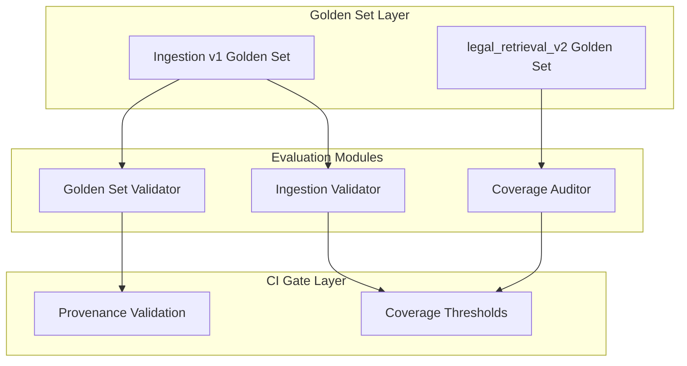

# Queued-ingestion security and fidelity gate

This directory is the CI quality gate for the bulletproof-ingestion roadmap
(issue #107, plan sections "the pipeline never lies", "OCR/source fidelity",
"prompt-injection fixtures", "queued-ingestion CI quality gate").  It runs the
fixtures in `fixtures/` through the **real queued ingestion path** — the same
compiled `build_document_ingestion_graph` graph the Celery worker task
invokes — with hermetic fakes (in-memory object store, no-embedding provider,
no-model extraction, no database, no Neo4j, no network model calls).

The gate is **tokenizer-hermetic**: an autouse fixture in `conftest.py` pins
the chunker and fidelity token counters to a deterministic offline stub
(`_OfflineTokenizer`, ~1 token per whitespace word), so a fresh CI runner never
downloads HuggingFace assets.  Verified with `HF_HUB_OFFLINE=1
TRANSFORMERS_OFFLINE=1 HF_HOME=<empty dir>` — 9/9 pass with no network and no
cache.

Run it with:

```bash
uv run pytest evals/ingestion -q
```

CI runs exactly this command (see `.github/workflows/test.yml`,
"Enforce queued-ingestion fidelity and injection gate"); any assertion failure
fails the build.

## What is enforced (fails the build)

| Invariant | Proof |
|---|---|
| Fixture integrity | sha256 checksums in `fixtures/CHECKSUMS.sha256`; any mismatch fails closed before any run |
| Tenant scope | persisted chunk rows and document `ingestion_state` carry the server-issued tenant; the forged tenant in `injection_identity_override.md` / `injection_forged_boundaries.md` never appears as an identity field |
| Graph group binding | no `group_id`/`graphiti_group_id`/`allowed_doc_ids`/`tenant_id` keys can be planted by document content into chunk metadata |
| Contract identity | `contract_index` is a server-assigned subset of the conservative boundary function's contiguous range; the forged "contract 7 of tenant X" claim is inert |
| Table preservation | the control fixture's parsed table must survive into chunks (`table_loss_ratio == 0.0`) |
| Chunk plausibility | zero chunks for a non-empty document is `implausible` and degrades the terminal state to `completed_with_warnings` (fault-injected untruthful-success test) |
| Relationship-phase truth | the queued path persists `graph_relationships.status = skipped_not_implemented` (reason `relationship_extraction_not_implemented`) — never a vacuous `all([])` success |
| No fabricated numbers | OCR confidence/coverage are persisted as explicit `unavailable` when the hermetic path cannot measure them |

## Report-only (baseline first, enforcement after variance)

Source coverage and OCR confidence thresholds default to disabled
(`FidelityThresholds.source_coverage_min = 0.0`,
`ocr_confidence_min = 0.0`) per the plan's "CI first reports a baseline;
enforcement thresholds are enabled only after variance is understood".  The
metrics are still measured and persisted on every document.  Tightening them is
a one-line, versioned change in
`src/app/features/documents/domain/fidelity.py`.

## Deliberate scope boundary

These fixtures live outside `evals/corpus/` and the `legal_retrieval_v2` gold
manifest: the gold set is retrieval-labeled and SME-adjudicated (105 cases),
while this set is an ingestion-level security regression net that does not need
retrieval labels.  See `fixtures/README.md`.

---

# Ingestion Quality Evaluation

The ingestion quality evaluation infrastructure extends the existing retrieval
evaluation framework to cover document ingestion state validation, coverage
auditing, and CI gates for ingestion quality.

## Overview

This module provides:

- **Ingestion State Validation**: Validate declared ingestion states against
  actual ingestion states for documents referenced in golden sets
- **Coverage Auditing**: Identify gaps in case type coverage and generate
  recommendations for missing case types
- **CI Gates**: Pre-commit validation for golden sets to ensure quality thresholds
  are met before merging changes

## Architecture



## Usage

### Ingestion State Validation

Validate ingestion states for documents referenced in a golden set:

```python
import asyncio
from pathlib import Path
from app.ai.evaluation import (
    load_validated_golden_set,
    validate_ingestion_states,
    GoldenIngestionState
)

async def main():
    # Load golden set
    golden_path = Path("evals/golden/ingestion_v1.jsonl")
    load_result = await load_validated_golden_set(golden_path)
    golden_set = load_result.unwrap()

    # Define ingestion state provider
    async def get_ingestion_state(document_id: str) -> GoldenIngestionState:
        # In production, this would query the ingestion service
        # For testing, return a mock state
        return GoldenIngestionState.READY

    # Run validation
    report = await validate_ingestion_states(
        golden_rows=golden_set.queries,
        ingestion_state_provider=get_ingestion_state,
        policy="mechanically_verified"
    )

    print(f"Total results: {report.total_rows}")
    print(f"Passed: {report.passed_rows}")
    print(f"Failed: {report.failed_rows}")

asyncio.run(main())
```

### Coverage Audit

Analyze coverage gaps in a golden set:

```python
import asyncio
from pathlib import Path
from app.ai.evaluation import (
    load_validated_golden_set,
    audit_ingestion_coverage,
    generate_coverage_audit_report
)

async def main():
    golden_path = Path("evals/golden/ingestion_v1.jsonl")
    load_result = await load_validated_golden_set(golden_path)
    golden_set = load_result.unwrap()

    # Audit coverage
    report = await audit_ingestion_coverage(
        golden_rows=golden_set.queries,
        corpus_manifest=manifest,  # Optional, for corpus path resolution
        minimum_per_type=5
    )

    print(f"Total rows: {report.total_rows}")
    print(f"Case type coverage: {report.case_type_coverage}")
    print(f"Gaps found: {len(report.gaps)}")

    # Generate detailed report
    output_path = Path("evals/reports/coverage_audit.json")
    await generate_coverage_audit_report(golden_path, output_path)

asyncio.run(main())
```

### Golden Set Validation Before Commit

Validate a golden set before committing changes:

```python
import asyncio
from pathlib import Path
from app.ai.evaluation import validate_golden_set_before_commit

async def main():
    golden_path = Path("evals/golden/ingestion_v1.jsonl")
    
    result = await validate_golden_set_before_commit(
        golden_path,
        min_rows=20,
        min_per_case_type=5
    )

    if result.is_success:
        print("Golden set validation passed!")
    else:
        print("Validation failed:")
        for issue in result.failure():
            print(f"  - {issue}")

asyncio.run(main())
```

## CI Integration

The CI pipeline includes the following jobs:

1. **validate-provenance**: Validates golden set provenance and manifest presence
2. **coverage-audit**: Audits coverage of case types and identifies gaps
3. **ingestion-validation**: Runs ingestion state validation checks

See `.github/workflows/evaluation-ci.yml` for the full CI configuration.

## Thresholds

The following thresholds are enforced:

- **Minimum total rows**: 20 (for `ingestion_v1` golden sets)
- **Minimum per case type**: 5 rows per major ingestion case type
- **Case types**: `no_evidence_vs_ingestion_failure`, `index_not_ready`, `partial_coverage_answer`

## API Reference

### Functions

- `validate_ingestion_states()`: Validate ingestion states against declared expectations
- `audit_ingestion_coverage()`: Audit coverage of case types and identify gaps
- `validate_golden_set_before_commit()`: Run full validation suite before commit
- `generate_coverage_audit_report()`: Generate detailed coverage audit report
- `generate_coverage_summary()`: Generate human-readable coverage summary

### Classes

- `GoldenSetValidator`: Validator for golden set rows before committing changes

## File Structure

```
src/app/ai/evaluation/
├── ingestion.py          # Ingestion state validation
├── coverage_report.py    # Coverage audit report generation
├── golden_set_validator.py  # Pre-commit validation
├── schema.py             # Data models and types
└── __init__.py           # Public API exports
```

## Testing

Run unit tests with:

```bash
uv run pytest tests/unit/ai/evaluation/ -v
```

Run property-based tests with:

```bash
uv run pytest tests/unit/ai/evaluation/ -v -m property
```

## Error Handling

The module defines the following custom exceptions:

- `IngestionValidationError`: Base class for ingestion validation errors
- `MissingProvenanceError`: Golden set row missing provenance information
- `StateMismatchError`: Expected ingestion state does not match actual state
- `PolicyValidationError`: Ingestion validation failed under specified policy
- `GoldenSetValidationError`: Golden set validation failed during pre-commit checks

All errors include detailed context for debugging.

